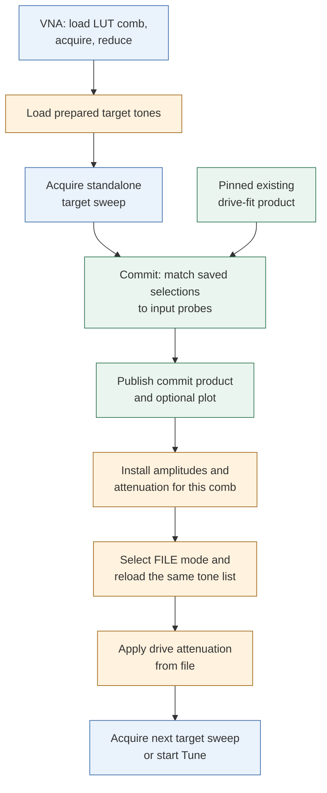
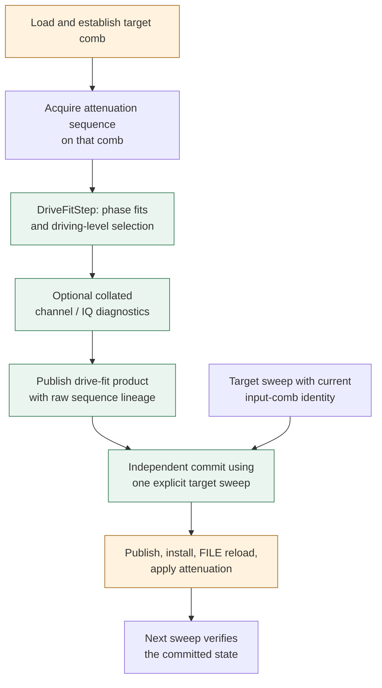
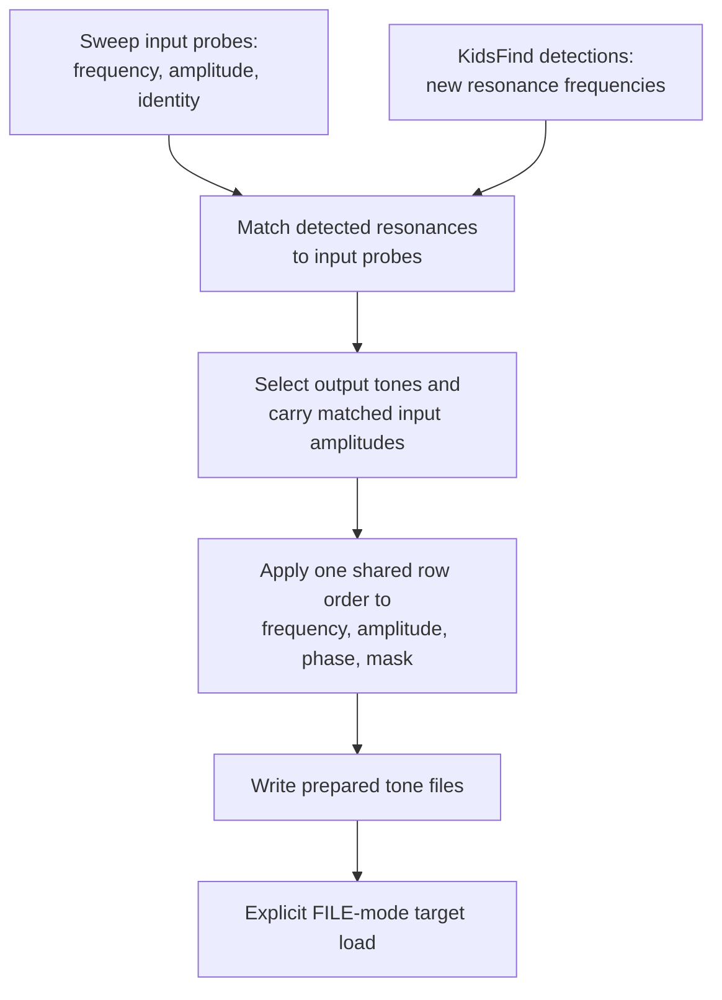
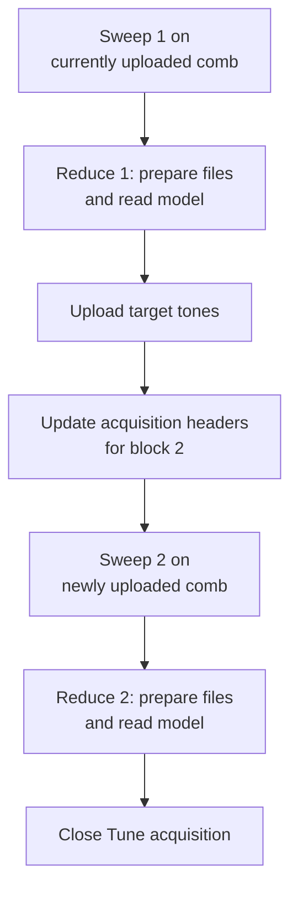

# Drive fit and Tlaloc handoff

## Purpose and status

Drive fitting selects useful driving levels for each resonator. Commit transfers
those selections to a current target comb, so its next loaded sweep can use the
saved drive fit without repeating the attenuation sequence.

This document owns the drive-fit workflow contract linked from the
[TolTECA specification](spec.md#drive-fitting). It distinguishes accepted user
requirements, the proposed operational sequence that implements them, and
unresolved power-model work. The [source audit](drive-fit-ot-tlaloc-evidence-20261020.md)
records the OT scripts, C++ command paths, v2 recipe, and inspected revisions.
The diagrams describe the intended v3 integration unless labeled **observed**.
They are not a claim that the complete integration is implemented or tested on
hardware.

## Accepted workflow boundaries

- `tolteca_kids.drive_fit`, configured under root `drive_fit`, combines an
  attenuation sequence through `DriveFitStep`, optional `DriveFitPlotStep`, and
  data-product output. It reuses TolTEC sweep preparation and the numerical
  phase fitter. Fitting preserves the v2 scientific results.
- The independent `drive_fit_commit` workflow consumes an existing published
  drive-fit realization and one target acquisition, with one sweep per selected
  network. It runs `DriveFitCommitStep`, optional `DriveFitCommitPlotStep`, and
  data-product output. It uses the shared KIDs tone matcher.
- Commit matches against the target sweep's **input probe comb**. In the intended
  reuse sequence, this sweep has not been reduced to prepare new tones, and its
  comb remains current. Finding is not a prerequisite for commit.
- Ordinary finding can prepare a different output tone list. In FILE mode it
  transfers recorded input amplitudes through the probe-to-detection match,
  preserving v2 behavior. This is a separate handoff from commit.
- The port preserves v2's Tlaloc file formats and command behavior. Pending C++
  reader changes must retain the unversioned v2 report's columns and row order,
  including its leading baseband frequency and variable finding count. Checks
  specific to versioned fit reports must not restrict the ordinary v2 handoff.
  A separate acquisition-model/next-tone report format is not required.
- The percentile cutoff controls excessive driving-power dynamic range. Keep
  the existing configurable policy and its default value of 10. Selecting a
  different cutoff and changing the power-normalization algorithm are separate
  decisions.
- Scientific results and diagnostics remain usable after raw files and runtime
  handles close. Reopening and plotting must not rerun fitting or change
  instrument settings.

## State and command boundaries

Each network has several independently changing states. The implementation and
operational instructions must identify which state a command changes.

| State | Contents | Owner and transition |
| --- | --- | --- |
| Acquired input | Actual probe frequencies, amplitudes, masks, available phases, attenuation and channel order for a sweep/block | Native acquisition metadata; remains the evidence for that acquisition |
| Published result | Fit or commit arrays, config, diagnostics, identities and lineage | Python workflow and data-product store |
| Prepared files | `targ_freqs.dat`, `default_targ_amps.dat`, `random_phases.dat`, `default_targ_masks.dat`, `atten_drive.dat` | Reducer/Tlaloc output in `etc/toltecN`; writing prepares the next load |
| Controller model | Read model parameters and candidate target frequencies | C++ report reader; reduction can change this without uploading a comb |
| Uploaded comb | Quantized frequencies and the synthesized DAC waveform | C++ tone-load command; LUT/FILE mode chooses amplitudes at load time |
| Applied attenuation | Hardware drive-attenuator setting | Explicit attenuation command; loading a tone file does not apply `atten_drive.dat` |

**Observed C++ behavior:**

| Operation | Acquisition | Prepared files / model | Uploaded comb / attenuation |
| --- | --- | --- | --- |
| `targ_sweep` | Acquires on the existing target comb; restores LO and sample rate afterward | No reduction or tone-frequency-file write | No new tone load or commit-attenuation application |
| `vna_reduce`, `targ_reduce` | Uses the selected acquisition | Invokes the external reducer; its output can replace files; C++ reads the report into the model | Does not call `targ_load` |
| `drivefit_commit` | Uses the selected target acquisition and saved fit | Invokes the external commit recipe; v2 writes amplitude and attenuation files | Does not upload tones or apply attenuation |
| `targ_load_amps_mode FILE` | None | Selects the amplitude source for a subsequent load | Does not itself reload the waveform |
| `targ_load_from_file` | None | Reads target frequencies/model | Uploads target tones using the selected amplitude mode; no attenuation-file application |
| `attens_set_drive_from_file` | None | Reads `atten_drive.dat` | Applies drive attenuation; no tone upload |
| `tune` | Two target sweeps | Reduces each sweep | Uploads between sweeps; no upload after the second reduction |

## Reuse after VNA: proposed operational sequence

The user-defined entry point is a new VNA calibration group, initialized from
the fixed VNA comb and its LUT. VNA reduction finds target frequencies; a target
load establishes the comb to which the saved drive fit will be transferred.
Any additional initialization iterations must finish before the commit target
is acquired.



1. Acquire the commit target on the loaded target comb. Do not run a tone-changing
   reduction or upload between this acquisition and its commit handoff.
2. Pin an existing fit realization for the same network. Match its reference
   frequencies to the recorded target input frequencies. Preserve target row
   order and retain match indices, shift, distances and fit flags.
3. Compute and publish the commit result. Run configured registration before
   the enabled Tlaloc output step. Publication success means the result exists;
   it does not mean hardware settings have changed.
4. Install the amplitude vector and scalar drive attenuation. The amplitude rows
   must correspond to the frequencies, phases and masks used by the subsequent
   load. The intended unchanged-comb path leaves those companion files intact.
5. Select FILE amplitude mode, reload that same target list, and explicitly apply
   the drive attenuation file. These are separate OT/Tlaloc actions. Complete
   both before taking the next sweep.
6. Use the next target sweep, or Tune's first sweep, to verify the applied settings
   and detector response. Its recorded header is the evidence of application.

Commit occurs **after** the target sweep following VNA initialization and
**before** the next sweep using the committed settings. A subsequent Tune may
recenter frequencies through its normal reduction and upload sequence.

The proposed command order above chooses tone reload followed by attenuation
application. Both commands must succeed before acquisition; no special meaning
is assigned to their relative order by the numerical recipe. On a partial
failure, the observing procedure must not report the commit as applied or start
the verification sweep automatically.

### A changed prepared tone list is a different case

An explicit reduction can replace `targ_freqs.dat` while the old comb is still
loaded. Equal lengths do not prove equal order or frequencies. Installing
input-order amplitudes beside that new list is not the unchanged-comb path.

The proposed v3 handoff must compare the target identity/order with the intended
reload list before installation, using the same LO and DAC frequency quantization.
A mismatch must be reported. It must not be
silently repaired by truncating amplitudes, sorting them independently, or
assuming matching channel numbers. The normal operational recovery is to finish
the intended tone update, acquire a new standalone target sweep, then commit
against that input comb. Support for committing directly to an explicitly
different destination tone table would need its own destination match contract;
it is not required for the user's present workflow.

## Fresh drive fit: proposed operational sequence

The attenuation sequence measures the response of one known loaded comb as drive
attenuation changes. The acquisition procedure must keep the probe identity,
ordering and amplitude convention coherent across that sequence. Recorded
headers, not the current contents of mutable Tlaloc files, establish the inputs.



- The fit workflow ends with its scientific result/product. It does not hide a
  commit or a hardware action inside fitting.
- A fresh fit feeds the same independent commit workflow used for reuse. The
  target may be a suitable explicitly selected member of the sequence if its
  comb remains the intended reload comb; otherwise acquire a new target sweep.
- The older OT scripts can reduce each power step without uploading between
  steps. This leaves the measured comb fixed but can change prepared disk files.
  A fresh-fit handoff must satisfy the same reload-list check as reuse.
- Choose attenuation range and spacing through the observing procedure; do not
  freeze the historical script's number of steps as a scientific requirement.

## Ordinary FILE-mode finding and Tune

Finding prepares tones for the next load. A detection has both its new frequency
and a correspondence to the sweep's input probe. V2 uses this correspondence to
carry the input amplitude into the output tone list.



The ordinary writer must preserve v2's matching behavior and apply its selection,
fixed-count/placeholder rules and FFT ordering consistently to every tone column.
It must not substitute unit amplitudes for available recorded FILE-mode values.
`TonePrepare` owns selection and the shared row order. Its default count policy
allows variable counts for VNA and standalone target sweeps and retains the input
count for Tune. Products retain every prepared block; optional installation uses
the last sweep block. The v2 frequency report and its three companion files remain
the handoff to the existing Tlaloc loader.
In LUT mode, Tlaloc evaluates the LUT at the loaded frequencies; in FILE mode,
the coefficients are replacement amplitudes, not multipliers on the LUT.

Commit leaves the current frequency list in place. Ordinary finding can create
a new list. These two writers share Tlaloc file conventions but have different
input and row-selection contracts.

**Observed Tune expansion in C++:**



There is no final tone upload in this function. After Tune, the active comb is
the one used for sweep 2; the second reduction can leave newer prepared files or
model values. A later file load must therefore be treated as another tone change.
This distinction also applies when choosing a Tune block as an offline input;
the operational reuse sequence above deliberately uses a standalone target.

## Scientific result and product contracts

| Workflow | Persisted science | Diagnostics | Lineage / product |
| --- | --- | --- | --- |
| `drive_fit` | Per-power fits, selection flags, selected attenuation and reference-comb metadata needed to interpret them | Summary plus channel-selectable/collated IQ circles and actual fit traces across powers, including flagged channels | `dp_drivefit`; every raw sequence member retained through `dpa_drivefit_raw_obs` |
| `drive_fit_commit` | Current input order, reference matches, original/fill/clipped selections, replacement amplitudes and global attenuation | Match residuals and shift, flags, amplitude/attenuation effects; power estimates only with stated model and inputs | `dp_drive_fit_commit`; primary target through `dpa_drive_fit_commit_raw_obs`, exact namespaced fit realization through `dpa_drive_fit_commit_drivefit` |

Steps own typed artifacts. Product publication uses the shared
[publication contract](spec.md#publication-ownership-and-atomicity) and supports
DPDB registration. A published fit reference resolves to a fixed realization
before commit computation; a later tag movement must not change its lineage.

The shared `TlalocOutput` step installs prepared files only when enabled with an
explicit destination. It runs after the acquisition's configured product
publication and registration succeed. Batch run bookkeeping can finalize later.
It must not be described as uploading tones or applying attenuation.
Replaying a saved commit must use its saved settings and target identity rather
than rematching against a different fit or reading a different mutable target.

Runtime sections remain independent:

| Root section | Responsibility |
| --- | --- |
| `kids` | Ordinary single-acquisition processing and finding/tone preparation |
| `drive_fit` | `fit`, optional `plot`, `output`, and input selection |
| `drive_fit_commit` | Pinned `reference`, `commit`, optional `plot`, `output`, optional `tlaloc_output`, and target selection |

Package ownership does not require nesting these workflow sections below `kids`.
An OT recipe composes these workflows and hardware commands; it does not own
another copy of their scientific algorithms.

## Numerical policy and fixed-total power normalization

The normalization correction accepted on 2026-10-21 supersedes the initial
max-tone-amplitude calculation. Fit values, matching, percentile selection and
the configured downward attenuation step retain their previous behavior. The
separate LO-midpoint discrepancy is outside this correction.

The fit product records each selected channel's fraction of total reference DAC
power. Compute these fractions over the full acquired comb before selecting
channels, including masks and Tlaloc's last-assignment ownership of duplicate
DAC bins. Reference normalization must survive storage and matching; commit must
not renormalize the matched subset. A product lacking these fractions requires
a new fit run.

For each target tone, let `r_i` be its matched reference power fraction and
`A_i` its selected attenuation. Preserve the existing policy: accept flag-zero
values below `adrv_max`, clamp negative accepted values to zero, fill rejected
values with `adrv_fill_perc`, and clip below `adrv_ref_perc`. Denote the resulting
attenuation by `A_policy_i` and the reference percentile by `R`.

```text
requested fractional output power: t_i = r_i * 10**(-A_policy_i / 10)
relative replacement coefficient:  b_i ∝ sqrt(r_i) * 10**((R - A_policy_i) / 20)
exact global attenuation:          A_exact = -10*log10(sum(t_i))
quantized global attenuation:      A_out = floor(A_exact / step) * step
```

The sum includes each emitted output DAC bin once. Output rows sharing a bin
must request equal power; reject conflicting requests. Normalize the written
coefficients so their maximum is one. Commit writes them as replacements in
input-probe order; it does not multiply them into the target input LUT again.

Keep `adrv_ref_perc` configurable at 10 and `adrv_fill_perc` at 50. Keep the
existing downward `adrv_ref_step`, default 0.25 dB. Under this model, quantization
produces a common power excess `A_exact - A_out` smaller than one step. Numerical
roundoff within 1e-12 steps of a grid point is snapped to that point.

Persist the named power model, unquantized attenuation, policy-adjusted power,
predicted achieved power and residual. Power values are relative to total DAC
power at the drive-attenuator output; they are not calibrated detector powers.

Tlaloc holds the synthesized complex waveform peak fixed. Its total DAC power
can therefore vary with frequencies, phases, masks and relative amplitudes.
The fixed-total model corrects the inconsistency identified by the `roach_tone`
check; it does not claim exact waveform-power closure. Full waveform calibration
and phase-aware power prediction remain separate work. The historical
[power audit](drive-fit-power-audit-20261020.md) and the
[normalization report](drive-fit-normalization-20261021.md) give the evidence and
limits of the approximation.

## Implementation order and acceptance

The next implementation work should follow these boundaries. This specification
does not itself alter the reducer, OT scripts, C++ or live files.

| Order | Work | Completion evidence |
| --- | --- | --- |
| 1 | Preserve fit/commit numerical behavior and independent workflow outputs | Fit/matching/policy retain the v2 baseline; commit normalization satisfies fixed-total power closure; saved products reopen |
| 2 | Complete ordinary finding's recorded-amplitude transfer and common tone-file ordering | FILE-mode fixture with unequal input/output counts and nonuniform amplitudes; expected coefficients follow actual probe matches and the same permutation as frequencies |
| 3 | Make commit installation's unchanged-comb assumption explicit and checked | Permuted or changed destination list fails before replacement; matching list writes exactly one amplitude per input probe; no frequency rewrite |
| 4 | Verify the ordinary tone writer and C++ reader against the established v2 handoff | Frequencies, amplitudes, phases, masks and report columns preserve v2 conventions, including variable-count finding. Correct pending C++ restrictions that conflict with this handoff; retain versioned-report checks within their own schema. |
| 5 | Align OT orchestration with the proposed reuse and fresh-fit sequences | Command trace includes FILE reload and attenuation application before next acquisition; failed publication/install/load/apply prevents the success path |
| 6 | Validate the physical power model separately | Full-comb numerical closure and measured post-commit response, with explicit calibration, phase provenance and tolerance |

Minimum acceptance cases:

- **Reuse:** new VNA group, standalone unreduced target, prior fit, different
  reference/target channel counts. Commit preserves target input order and the
  next loaded header contains the committed amplitudes and attenuation.
- **Fresh fit:** one coherent loaded comb across multiple drive attenuations;
  optional per-step reduction does not silently replace the comb used for the
  final commit load.
- **Ordinary FILE finding:** output tones inherit the amplitudes of their
  matched input probes, including selection and ordering changes.
- **Tune:** the second block records the intermediate upload; the final reduction
  is not mistaken for a final upload.
- **Publication:** fit and commit are independently registered, with exact
  reference lineage. Plotting/reopening does not cause Tlaloc writes.
- **Failure:** a changed destination tone list or a failed prerequisite does not
  proceed to an apparently successful hardware application. Existing per-file
  atomic replacement is not described as a transaction across all files.
- **Science:** percentile clipping remains at the configured baseline; parity
  and absolute-power closure are reported as separate results.

The source audit identifies the current gaps and the script variants requiring
reconciliation. No telescope sequence or hardware-power validation has been
executed for this specification.
