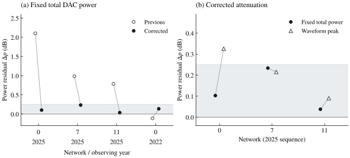

# Absolute power normalization in TolTEC drive-fit commit

Technical note · 21 October 2026

## Abstract

Drive-fit commit converts independently selected resonator drive levels into
a single tone comb and a common attenuation. This conversion requires an
absolute normalization as well as the correct ratios between tone amplitudes.
We show that the v2 prescription, inherited by the initial v3 implementation,
omits the change in the sum of squared comb amplitudes under the fixed total
DAC power model used by `RoachTonePower`. The required attenuation is the
negative logarithm of the summed requested fractional powers. Applying this
expression to a seven-sweep TolTEC reference sequence reduces the predicted
power excess from 2.103, 0.984 and 0.788 dB to 0.103, 0.234 and 0.038 dB for
networks 0, 7 and 11, respectively. The residuals follow from retaining
downward quantization in 0.25 dB steps. The fitted drive levels and relative
emitted amplitudes are unchanged. A calculation using recorded tone phases
also demonstrates the limit of this result: Tlaloc fixes the waveform peak,
and changes in crest factor leave an additional residual that the fixed total
power approximation does not describe.

## 1. Introduction

A drive-fit sequence samples the resonator response at several values of the
common drive attenuation. The resulting fit assigns a preferred attenuation
to each channel. Those preferences cannot be applied independently to the
hardware attenuator. Instead, commit must construct a new set of relative
tone amplitudes and choose one common attenuation such that the individual
tones reproduce their selected powers.

Correct amplitude ratios determine the ratios of tone powers, but do not
determine their common scale. In particular, normalizing the largest amplitude
to unity does not determine the total power of a multitone waveform. The
question addressed here is whether the commit attenuation is consistent with
the power distribution assumed by the existing `RoachTonePower` model [1].

We first derive the normalization within that model and identify the missing
term in the earlier recipe [2]. We then evaluate the change on a compact
initialization sequence covering one network in each TolTEC array, with a
longer calibration sequence as an additional check. Finally, we compare the
fixed total power prediction with the waveform normalization implemented by
Tlaloc [3]. These are calculations from recorded sweeps; no post-commit power
measurement is available in this comparison.

## 2. Power model and attenuation solution

### 2.1. Reference and output combs

Let $a_j$ denote the nonnegative amplitude of emitted reference tone $j$.
Under the fixed total DAC power approximation, its fractional power is

$$
S_a=\sum_j a_j^2, \qquad r_j=\frac{a_j^2}{S_a}.
$$

The sum includes the entire emitted reference comb, including tones that are
not selected for fitting or subsequently matched to the output. Here and
below, a tone means a distinct active DAC frequency bin. Masked bins do not
contribute. If several input rows address the same bin, Tlaloc retains the
last assignment; the emitted amplitude is that of the controlling row [3].
Counting overwritten rows as additional emitted tones gives an incorrect
denominator.

Let $m(i)$ identify the reference tone matched to output tone $i$, and let
$A_i$ be its selected attenuation in dB, after filling rejected fits and
applying the percentile cutoff. The desired power, expressed as a fraction
of the reference total DAC power, is

$$
t_i=r_{m(i)}10^{-A_i/10}, \qquad
p_i^\star=10\log_{10}r_{m(i)}-A_i.
$$

The logarithmic quantity $p_i^\star$ refers to the drive-attenuator output,
relative to total DAC power. It is not an absolute detector-input power in
dBm; downstream losses and an absolute power calibration are not included.
For output coefficients $b_i$ and common attenuation $A$, the same model
predicts

$$
p_i(b,A)=10\log_{10}\!\left(\frac{b_i^2}{\sum_k b_k^2}\right)-A.
$$

All logarithmic powers in this note are in dB. Equation (3) is the v2
per-tone DAC power expression [1], with the common drive attenuation
subtracted and the arbitrary total-power offset removed.

### 2.2. The absolute normalization

Correct relative powers require $b_i$ to be proportional to $\sqrt{t_i}$.
Writing $T=\sum_i t_i$ and choosing the conventional maximum amplitude of
unity gives

$$
b_i=\sqrt{\frac{t_i}{\max_k t_k}}, \qquad
\frac{b_i^2}{\sum_k b_k^2}=\frac{t_i}{T}.
$$

Substitution into equation (3) yields
$p_i(b,A)=p_i^\star-10\log_{10}T-A$.
Thus all requested powers are recovered simultaneously by

$$
A_\star=-10\log_{10}T
       =-10\log_{10}\!\left(\sum_i r_{m(i)}10^{-A_i/10}\right).
$$

The reference denominator in equation (1) and the output sum in equation (5)
have different roles. The former defines each tone's power during the
reference measurement; the latter is the total power requested for the new
comb. The solution therefore permits different reference and output tone
counts. It must not renormalize the reference fractions over only the matched
subset. Multiple output rows sharing one DAC bin can represent only one
emitted power; conflicting requests for that bin have no simultaneous solution.
A passive attenuator also requires $T\leq1$; a larger requested total cannot
be realized by attenuation alone.

### 2.3. Missing term in the earlier prescription

For a common reference and output tone set, write
$\ell_i=a_i/\max_j a_j$. With percentile reference attenuation $R$, the
earlier recipe [2] computes

$$
q_i=\ell_i10^{(R-A_i)/20}, \qquad
b_i=\frac{q_i}{q_{\max}}, \qquad
A_{\rm old}=R-20\log_{10}q_{\max}.
$$

These expressions precede attenuation quantization. The relative
coefficients agree with equation (4), but the attenuation compensates only
for the maximum coefficient. Combining equations (5) and (6) gives the
omitted term explicitly:

$$
A_\star-A_{\rm old}
=10\log_{10}\!\left(\frac{\sum_i\ell_i^2}{\sum_i b_i^2}\right).
$$

The percentile reference $R$ cancels from the normalization, although the
cutoff still affects the selected values $A_i$. Equation (7) explains why a
change in amplitude distribution generally requires a change in common
attenuation even when the largest coefficient remains unity. The sign and
magnitude depend on the comb; the correction is not a universal additive offset.

As an analytic example, consider two equal reference tones with requested
attenuations of 10 and 20 dB and no cutoff. Both prescriptions give
$b=(1,\sqrt{0.1})$. The earlier attenuation is 10 dB, whereas the requested
total fractional power is $T=0.055$, giving $A_\star=12.596373$ dB. The
earlier setting therefore exceeds both requested tone powers by 2.596373 dB.
This discrepancy follows without specifying the absolute DAC power.

### 2.4. Attenuation quantization

Retaining the existing downward rounding with step $s$ gives

$$
A_{\rm out}=s\left\lfloor\frac{A_\star}{s}\right\rfloor, \qquad
\Delta p_i=p_i(b,A_{\rm out})-p_i^\star=A_\star-A_{\rm out}.
$$

The residual is common to all emitted tones and satisfies
$0\leq\Delta p_i<s$. For $s=0.25$ dB, the two-tone example gives
$A_{\rm out}=12.50$ dB and $\Delta p_i=0.096373$ dB. This bound follows
from the chosen rounding rule within the fixed total power model; it is not
a bound on instrumental or fitted-power uncertainty. Nearest-step rounding
would address a different objective. The present calculation retains the
configured rule and percentile cutoff.

## 3. Reference observations and numerical methods

The primary data are the 2025 October 31 initialization sequence, observation
145484, subobservations 1–7, scan 1. The seven target sweeps span drive
attenuations of 4–16 dB in 2 dB increments. Commit is evaluated against the
standalone target sweep 145485/0/1. The three networks contain 1,493 channels
in total, with one distinct emitted DAC bin per channel. The output uses the
target's input-probe ordering; no intervening finding operation or tone-list
replacement is introduced.

Table 1. Channel populations in the compact reference sequence. “Cutoff” counts accepted selections whose attenuation is increased to the tenth percentile. Filled channels receive the median accepted attenuation.

| Network | Array | Channels | Accepted | Filled | Cutoff |
| --- | --- | ---: | ---: | ---: | ---: |
| 0 | a1100 | 632 | 505 | 127 | 48 |
| 7 | a1400 | 389 | 245 | 144 | 25 |
| 11 | a2000 | 472 | 24 | 448 | 3 |

The fit uses `a_ref=0.2` and `weight_window_Qr=12000`. Commit retains
`adrv_max=30 dB`, median filling, a tenth-percentile lower cutoff on selected
attenuation, and $s=0.25$ dB. Filled values are assigned operating levels,
not independently determined resonator optima. In particular, only 24 of the
472 network-11 channels have accepted selections (Table 1); the normalization
calculation does not improve this acceptance rate.

The two workflow runs differ in their commit normalization. The nonlinear
fit, tone matching, filling and cutoff calculations are held fixed. Power
residuals are evaluated independently by executing the original v2
`RoachTonePower.P_dac_dbm_per_tone` expression on the emitted reference and
output combs [1, 4]. The same arbitrary total DAC power is used in both,
so it cancels in the difference. Positive residuals mean excess output power
relative to equation (2). These are deterministic forward calculations,
not estimates of measurement scatter.

The baseline is the initial v3 fit and commit applied to these data, isolating
the attenuation change. It does not assert complete v2 fit parity: a previously
identified difference between the measured LO midpoint and the header LO
value affects the network-11 v2/v3 fit comparison. The LO convention and the
fit kernel are held unchanged here.

For an additional check, we use the 31-sweep, network-0 calibration ICS 17068
from 2022 December 11. Its 685 channel rows occupy 654 distinct DAC bins.
The 31 overwritten rows provide a case in which row count and emitted-tone
count differ.

## 4. Results

### 4.1. Compact initialization sequence

Table 2 gives the previous attenuation, the continuous solution from equation
(5), and the quantized setting. The correction increases the written
attenuation by 2.00, 0.75 and 0.75 dB for networks 0, 7 and 11. Because the
relative coefficients are unchanged, these changes reduce every tone's
predicted power in the corresponding network by the same amount.

Table 2. Attenuation settings and fixed total power residuals for the compact reference. All entries are in dB. Residuals are evaluated after quantization; displayed precision describes the numerical calculation, not instrumental accuracy.

| Network | Previous $A$ | $A_\star$ | $A_{\rm out}$ | Previous $\Delta p$ | Corrected $\Delta p$ |
| --- | ---: | ---: | ---: | ---: | ---: |
| 0 | 6.25 | 8.352639 | 8.25 | +2.102639 | +0.102639 |
| 7 | 7.00 | 7.983699 | 7.75 | +0.983699 | +0.233699 |
| 11 | 12.00 | 12.787755 | 12.75 | +0.787755 | +0.037755 |

The residuals all lie within the interval predicted by equation (8)
(Figure 1a). Every pre-existing fit data array, including selected attenuation
and flags, is exactly equal between runs. Match indices, frequency residuals,
filled attenuations and cutoff decisions are also equal. The largest change
in an output amplitude coefficient is $2.22\times10^{-16}$, consistent with
floating-point rounding. The independent forward calculation agrees with the
stored per-tone power diagnostics to within $2\times10^{-13}$ dB.

<figure id="fig-residuals">

<figcaption>Figure 1. Computed power residuals relative to the selected, filled and cutoff-adjusted drive levels. (a) Previous and corrected fixed total power calculations; the final pair is the historical network-0 calibration. Connecting lines identify paired calculations, not a continuous sequence. (b) Corrected residuals under fixed total power and Tlaloc waveform-peak normalization, using recorded phases for the compact sequence. The shaded interval, 0–0.25 dB, is the quantization range for the fixed total power model; it does not constrain the waveform model. Markers represent deterministic comb calculations, not measurements with statistical error bars.</figcaption>
</figure>

### 4.2. Historical calibration and quantization

For ICS 17068, equation (5) gives $A_\star=13.636541$ dB. The written
attenuation changes from 13.75 to 13.50 dB, and the fixed total power residual
changes from −0.113459 to +0.136541 dB. In this case, the magnitude of the
quantized residual becomes slightly larger: the previous setting happened
to be closer to the continuous solution. A correct continuous normalization
followed by downward rounding therefore need not improve the absolute
residual for every comb.

The 483 accepted selections, 202 filled values and 49 cutoff-limited selections
are unchanged. Coefficients controlling emitted DAC bins agree within
$2.22\times10^{-16}$. Overwritten entries differ by up to 0.0045853, because
their recorded power fractions now refer to the controlling bin; these entries
do not alter the synthesized waveform. No tone-phase headers are recorded in
this sequence, so an equivalent waveform calculation is not available.

## 5. Waveform normalization and physical interpretation

The fixed total power model is not identical to the DAC synthesis procedure.
Tlaloc constructs a complex waveform by inverse FFT and divides both I and Q
by its maximum complex magnitude [3]. It therefore fixes the waveform peak.
Redistributing amplitudes can change the peak-to-RMS ratio, or crest factor,
and hence change the total power even when the peak remains fixed.

Let $M_a$ and $M_b$ be the maximum complex magnitudes of the unnormalized
reference and output waveforms, respectively. With the same inverse-FFT
convention in both, the residual relative to the selected reference power is

$$
\Delta p_i^{\rm peak}
=20\log_{10}\!\left(\frac{b_i}{a_{m(i)}}\right)
 +A_i-A_{\rm out}+20\log_{10}\!\left(\frac{M_a}{M_b}\right).
$$

Writing $S_b=\sum_i b_i^2$, the difference from the fixed total power
prediction is

$$
\Delta p_i^{\rm peak}-\Delta p_i
=20\log_{10}\!\left(\frac{M_a}{M_b}\right)
 +10\log_{10}\!\left(\frac{S_b}{S_a}\right).
$$

This is the change associated with the two combs' crest factors. It is common
to the tones in this calculation, but depends on amplitudes, phases and
frequency-bin placement. It cannot in general be inferred from the largest
tone amplitude alone.

Every sweep in the compact reference has recorded phases, which are constant
over the seven fitted drive levels within each network. Equation (9) is
evaluated using the recorded frequency bins and phases, assuming that commit
retains the target sweep's phases and masks. Table 3 and Figure 1b give the
result.

Table 3. Power residuals under waveform-peak normalization. The last column is the corrected waveform residual minus the corrected fixed total power residual. All values are in dB and are conditional predictions from recorded waveform parameters.

| Network | Previous $\Delta p^{\rm peak}$ | Corrected $\Delta p^{\rm peak}$ | Crest-factor contribution |
| --- | ---: | ---: | ---: |
| 0 | +2.326037 | +0.326037 | +0.223397 |
| 7 | +0.965043 | +0.215043 | −0.018656 |
| 11 | +0.840251 | +0.090251 | +0.052496 |

The attenuation correction reduces the waveform-model residual in all three
networks, but does not eliminate it. Network 0 retains a 0.326 dB excess,
larger than one attenuation step, despite satisfying the fixed total power
bound. This is consistent with the 0.223 dB crest-factor contribution in
equation (10), added to the 0.103 dB quantization residual.

These results establish consistency with a specified power model, rather
than an absolute calibration of resonator power. The accepted drive levels
themselves have fitting uncertainty, filled channels lack accepted optima,
and the waveform calculation assumes the recorded phases and masks are
retained. A post-commit measurement would be needed to assess actual power
recovery, including analog-chain effects. Neither the model residuals nor
the number of computed digits supplies that measurement uncertainty.

## 6. Conclusions

Under the fixed total DAC power approximation, the common attenuation is
determined by the sum of the requested fractional tone powers. Normalization
by the largest amplitude gives the correct relative comb but omits the
sum-of-squares term required for the absolute power scale. The corrected
expression leaves the fitted drive levels and emitted relative amplitudes
unchanged and reduces the compact reference's power discrepancies to the
residual imposed by the retained attenuation quantization.

Two qualifications matter. Downward rounding does not minimize absolute
error for every comb, as the historical calibration illustrates. In addition,
Tlaloc's peak-normalized waveform introduces a crest-factor term beyond the
fixed total power approximation. The present correction resolves the
attenuation calculation within that approximation; the waveform calculation
quantifies the remaining model dependence for the available reference data.

## Appendix A. Computational record

V3 stores each fitted channel's reference `power_fraction` using the complete
acquired comb. This makes equation (5) reproducible when only a subset of
channels is fitted or later matched. Fit products lacking these fractions
must be regenerated. The commit product records `atten_drive_exact` and the
per-tone quantities `power_policy_db`, `power_commit_db` and `power_error_db`.
The output amplitude file is a replacement vector in target input-probe
order, not a further multiplication by the target input amplitudes. The
existing Tlaloc file contract is retained.

The comparison uses the initial v3 products in `run/drive-fit-full-20261021/`
and corrected products in `run/drive-fit-normalization-20261021/`. The latter
directory contains the exact workflow configurations, product manifests,
per-channel ECSV comparisons and JSON summaries. The [comparison program][comparison]
evaluates the original forward model independently of the attenuation solver.
Analytic and numerical checks include the two-tone example, invariance to
common amplitude scaling, changed tone counts, channel subsets, masking and
repeated DAC bins. Implementation validation and source hashes are recorded
in [provenance.json][provenance].
The [manuscript renderer](probes/render_drive_fit_normalization_report.py)
typesets this note and generates Figure 1 from the saved numerical comparisons.

The calculation describes the TolTECA working tree based on revision
`542c86a0a955edaa4a293521c55a18221952cbb1`, including the uncommitted v3 port.
The recipe reference is `taco_recipes` revision
`c9e73647f8096cda48485a9f551eef5cfb467a48`; the fit reference is
`kid_phase_fit` revision `4f4c9a71e51d88e41980c5932bd973722a6906a0`.
No live instrument settings were installed for this comparison.

## References

1. TolTECA v2, `tolteca_kids/roach_tone_power.py`,
   `RoachTonePower.P_dac_dbm_per_tone`. Local production source;
   SHA-256 `605d1bf054fc0b497a92b44c1e540ad068557e3593ade2c2a2eae323b1fd51e1`.
2. `taco_recipes`, `scripts/drivefit/dispatch_drivefit.py`,
   `DriveFitCommit.compute_ampcor`; revision given in Appendix A.
3. Tlaloc, `src/ToltecRoachManager.cc`, `dac_comb`. Local C++ source for
   frequency quantization, masking, bin assignment and common complex-waveform
   peak normalization; source hash in [provenance.json][provenance].
4. [Drive-fit normalization comparison program][comparison] and
   [preceding power audit](drive-fit-power-audit-20261020.md).
   The [workflow specification](drive-fit-workflow-spec.md) records the
   operational contract.

[comparison]: probes/drive_fit_normalization.py
[provenance]: provenance.json
