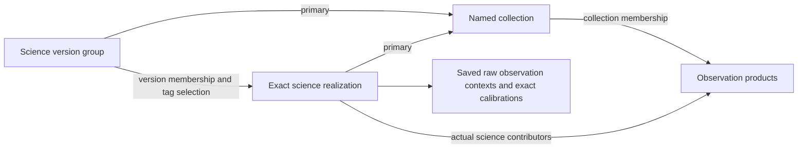

# Data products

- Users work with related observations and results across observing-site,
  archive and local workspaces. Data products let them locate available data and
  reuse selected results without rerunning the producing workflows.
- Scientific domains determine product contents and provenance. This domain
  defines how products are described, stored, selected and reopened.
- `tolteca_datamodels` owns the portable product model and the filesystem store.
  `tolteca_db` registers the same records for shared queries; see
  [Handoffs](#handoffs).

## Products, items and indexes

- A product (DP) is one independently identified observation, acquisition,
  collection or result. It holds its identity, typed metadata, items,
  associations, tags and audit facts. Each realized scientific product is a first-class
  product; a run records the producing activity and is not part of a product's
  identity.
- An item describes one constituent data resource of its product. Several
  products can use the same file without sharing their item metadata.
- An index is the portable document that describes a product and the locations
  of its items, with the supporting records needed for exchange: locations,
  namespace, actors and a run snapshot. Payloads stay in their own files.
  Document context does not become product identity.
- The product model defines products, runs, associations, artifact ownership and
  named selections independently of any storage representation. The filesystem
  projection and database registration map the same relations.
- The generic records (`core.data_prod`) import no instrument, no concrete product
  package and no database. Another application can supply its own metadata
  schema, index type and product policies. `tolteca_datamodels.data_prod` supplies
  the TolTEC metadata types, observation identity rules, interface calibration
  references, batches and the `dataprod_toltec` store.
- Product metadata is typed and strict. It validates supplied values, defaults and
  assignments, and rejects unknown fields; portable documents and database
  registration use the same field contracts. A raw-acquisition product requires
  explicit master, observation, subobservation and scan values. Partial interface
  evidence remains representable without a complete product identity.
- Typed product metadata owns descriptive and scientific facts, including the
  product name; names need not be unique. Item metadata describes the constituent;
  storage facts belong to the item's source. Relationship facts belong to the
  association.
- An index is internally consistent: each item declares its source location, a
  location/path pair occurs once per product, an included namespace matches the
  product's namespace, and actor, execution and store-run records agree with their
  keys and references. These checks concern the document's records, not payload
  existence or database registration.
- Saving and reading an index preserves field values, explicit nulls, field types
  and references under the same strict validation; computed fields are recomputed.
  It does not preserve YAML formatting or comments. Reading rejects
  language-specific object tags.

## Product types and identifiers

### Product types

| DP type(s) | Design role |
| --- | --- |
| `dp_obs` | Represents one observation. Lists its known acquisitions through associations to their `dp_raw_obs` products. |
| `dp_raw_obs` | Represents one acquisition. Lists its known files through `DataProdItem` records. |
| `dp_raw_obs_proc` | One realized acquisition-level result, shared by its interfaces. Each producing run creates a distinct product in a version group. |
| `dp_science` | Science reduction result containing maps, optional source catalogs and diagnostics from one or several contributing observations. |
| `dp_pointing` | Measured pointing solution/PPT with its supporting maps, fits and diagnostics. Application to another observation is a resolved calibration choice. |
| `dp_beammap` | Detector beam characterization, including beam maps, fitted properties/APT and diagnostics. |
| `dp_apt` | Local detector rosters, array properties, identity-reference lineage and acquired-channel projections. |
| `dp_version_group` | Stable logical product managing versions of one declared DP type. Its metadata declares the managed non-singleton DP type. |
| `dp_cal_group` | Intrinsic connected component of the per-file calibration graph projected onto raw-acquisition nodes. May contain multiple VNAs; the earlier VNA supplies its UID, with absorbed UIDs retained as redirects. |
| `dp_named_group` | General-purpose named collection. Can supply the primary scope for a multi-observation reduction; see [Named-group primaries](#named-group-primaries). |
| `dp_catalog` | Reserved for an independently produced and selected source-catalog result. A catalog emitted with a science reduction can remain an artifact of that result. |
| `dp_drivefit`, `dp_focus_group`, `dp_astig_group`, `dp_oof_group` | Follow the shared [association](#product-associations-and-primary-products) and [materialization](#materialization-ownership-and-atomicity) contracts. Group membership alone does not imply a completed scientific solution. |

- `dp_obs` and `dp_raw_obs` are singletons per observation and acquisition. They
  let users find an observation's acquisitions and files before or after
  processing. Acquisitions and files can be registered later; registration and
  discovery are independent of scientific processing.
- A `dp_raw_obs_proc` product holds acquisition-level transformations and
  diagnostics from its producing run. Observation-level science reduction is a
  separate product.

### Product identifiers

- A product is identified by a nonempty string UID and, for scoped products, a
  separate namespace UUID. Product UIDs and run UIDs do not contain namespace
  text. Equal UIDs in different namespaces identify different products.
- Observations, acquisitions, named groups, intrinsic calibration groups and
  version groups are global: their records have no namespace identity, and their
  indexes can appear in several namespace projections without creating additional
  products. Realized results are scoped by the namespace of their producing run.
  An unplaced derived product may omit its namespace until materialization assigns
  it; it does not become global.

| Product | Identity scope | UID |
| --- | --- | --- |
| Singleton `dp_obs` | Global | `{uid_obs}` |
| Singleton `dp_raw_obs` | Global | `{uid_raw_obs}` |
| Logical `dp_named_group` | Global | Stable producer-assigned group UID, preserved by import and refresh |
| Version group for any non-singleton product | Global | `{logical_product_identifier}` |
| Any realized non-singleton product | Producing run namespace | `{version_group.uid}/{run_uid}` |

- Entity identifiers follow [observation and interface identity](observation-data.md#observation-and-interface-identity).
  Observation and raw-acquisition product UIDs share one master-label grammar: an
  ASCII letter followed by ASCII letters or digits. Canonical UIDs use a lowercase
  master and unpadded nonnegative integer components; normalization preserves the
  recorded master spelling. Generic product references neither infer a product
  type nor normalize a UID.
- The producer defines the logical product identifier, for example
  `{uid_raw_obs}_proc` for processed acquisitions and `{dp_type}_{primary.uid}_g{N}`
  for grouped analyses, where `N` counts the contributors the producer defines.
  Producers distinguish different contributor sets with the same primary and count
  when they are different logical products.
- One run can consume products from several namespaces and produce results in
  several output namespaces. The outputs share the run UID; each destination
  supplies its namespace and local run name. One realization per logical result
  per execution is allowed in each namespace.
- Consumers use recorded relationships, not UID text, to find provenance, product
  type or group membership. Copying an index or artifact preserves its identity.

## Associations, version groups and tags

### Product associations and primary products

- Product references and association targets identify a product by its nonempty
  UID and namespace UUID together.
- An association (DPA) is a directed, typed relation from the resulting product
  to a product used to construct or group it: processing links a result to its
  inputs, grouping links a group to its members. Source and destination describe
  the relation, not a parent/child hierarchy. Run-specific input selection refers
  to exact products.

| DPA type | Source DP → referenced DP |
| --- | --- |
| `dpa_obs_raw_obs` | `dp_obs` → `dp_raw_obs` for an acquisition belonging to that observation. |
| `dpa_raw_obs_cal_obs` | `dp_raw_obs` → calibration `dp_raw_obs`. |
| `dpa_raw_obs_proc_raw_obs` | `dp_raw_obs_proc` → its acquisition's `dp_raw_obs`, selected as primary. |
| `dpa_cal_group_raw_obs` | `dp_cal_group` → `dp_raw_obs`; original VNA primary edge stored, complete membership projected by the calibration query. |
| `dpa_drivefit_raw_obs` | `dp_drivefit` → `dp_raw_obs`. |
| `dpa_focus_group_raw_obs` | `dp_focus_group` → `dp_raw_obs`. |
| `dpa_astig_group_raw_obs` | `dp_astig_group` → `dp_raw_obs`. |
| `dpa_oof_group_raw_obs` | `dp_oof_group` → `dp_raw_obs`. |
| `dpa_named_group_data_prod` | `dp_named_group` → any DP. |

- A product's **primary** is the observation, acquisition or named collection
  used to place and browse it. Primary placement is distinct from the
  observations that contribute measurements.
- `dp_obs`, `dp_raw_obs` and logical `dp_named_group` are their own primary; their
  membership or calibration associations do not change that. For every other
  product the producer marks one association as primary, without changing its
  relationship type. Resolution follows the marked associations until it reaches
  one of those terminal products; it never chooses a member of a collection.
- Primary resolution uses complete product references and reports missing
  targets, missing or ambiguous primary selections, lookups that return another
  product, and cycles.
- Association types are registered with the product type they reference.
  Primary resolution rejects an unregistered type and validates an observation or
  acquisition target against the identity grammar of its declared type.

### Version groups

- Every non-singleton product belongs to a version group (`dp_version_group`),
  which manages its alternative realizations. The group's metadata declares the
  managed product type (`content_data_prod_type`); every member has that type, and
  members may belong to different namespaces.
- A version group has stable global identity, no producing-run suffix and no
  version group of its own. A named group keeps its separate grouping role and is
  not a versioned result.
- Each realized product records its version group when it is materialized.
  Placement and member checks use that record, not the realized product's UID.
- Version membership and primary placement use separate relation types.
  `dpa_version_group_data_prod` identifies a member; `dpa_version_group_obs`,
  `dpa_version_group_raw_obs` or `dpa_version_group_named_group` places the group
  at its primary. An empty version group still resolves its primary.
- A tag is a label owned by one version group. It selects at most one outgoing
  membership association to a completed member, or is empty; an empty tag has no
  selected reference. Several labels may select the same member. A database has
  one selection per label and version group, across namespaces.
- Publishers choose tag labels, such as `ql-main` or `nightly-20260708`; local
  qualifiers use hyphens, and colons are reserved by convention for mapped
  remote-origin qualifiers (`taco:main`). Namespace paths neither generate nor
  constrain labels.
- Moving a tag changes the selection, not the product, its contents or its
  producing configuration. Tag-selection history is deferred.

## Sources and locations

- An item's source is a literal path relative to a declared location. Resolution
  joins it with the location and returns a full URI; encoding belongs to
  resolution, not to the stored path.
- A location declares its storage root. A relative root, including parent
  directories, resolves against the index directory, so a tree can move with its
  index. External roots use FileLoc's location formats; application configuration
  roots do not apply.
- Reading, resolving and writing keep relative references. Reopening a relocated
  index resolves them against its new directory.
- Source URIs describe placement. Moving or copying a representation does not
  redefine the product, run or association it represents; a registered copy adds
  a source of the same product. Matching identities at different locations do not
  imply equal inventories or synchronized mutable state.

## Batches and QA reviews

- A batch carries submission metadata, product, namespace and inventory indexes,
  actors and reviews for transfer. One batch may contain many products,
  namespaces and runs. It validates its own records without requiring related
  records in the same batch; registration checks references against the supplied
  records and the destination. Submission metadata does not replace product
  metadata, run context or inventory identity.
- An inventory index identifies the reporting owner of the records it carries.
  Inventory roles and maintenance belong to `tolteca_db`.

### Product QA reviews

- A review (`DataProdReview`) is an immutable assessment of exactly one product
  reference by an actor in a role and QA namespace. It records a UUID, creation
  time, note, complete boolean flag mapping, optional diagnostic run and evidence
  context. Attribution does not authenticate a caller or grant authority.
- A version-group tag may select the subject once; moving the tag does not move
  the review. Reviewing a group does not review its members.
- A QA namespace names the flag vocabulary, independently of storage namespaces.
  Flag meanings and acceptance policies belong to the reviewing workflow.
- True and false flags are explicit findings; an omitted flag has no finding from
  that review. An empty flag mapping still records a completed assessment. No
  severity, pass/fail or aggregate acceptance is inferred.
- A review cannot name itself as its predecessor, and an index's reviews concern
  that index's product. Indexes export complete review history with the reviewer
  actors; batches carry review-only deltas without rewriting artifacts. Review
  history persistence and the review command belong to `tolteca_db`.

## Namespaces, runs and actors

### Namespace identity and portability

- A namespace is a persistent output scope with a portable UUID, placed at a
  relative subpath (Tollan's lexical subpath) such as `ql` or `archive/taco/ql`.
  Renaming the path keeps the identity of the namespace, its scoped products and
  the executions recorded in it. Namespace placement and artifact storage roots are
  independent.
- `DataProdNamespaceIndex` is the one namespace document: the namespace record,
  actors and optionally selected runs. Reading namespace metadata does not load
  run history; selecting runs for transport does not change the namespace identity.

### Runs and tags

- A run identifies one execution with a portable UUID, independently of output
  namespaces and destinations. It records the full resolved workflow configuration
  and the exact selected inputs. Execution identity and completion belong to the
  workflow layer ([Processing workflows](processing-workflows.md#workflow-execution-identity)).
- In each output namespace a store run gives the execution a readable name and
  records the outcome of each requested output. Several store runs may reference
  the same execution; copies preserve execution and product identity.
- A run name is unique in its namespace: supplied by the caller, generated from
  the namespace counter, or the run UUID as text. A different UUID with the same
  namespace and name is a conflict.
- Generated counters never rewind and may skip values after an interruption;
  claimed names and counter values are not reused. A retry reuses its saved
  reservation. Allocation and run updates read and write only the affected run;
  their cost does not grow with the number of earlier runs. Collecting full run
  history is an explicit export.
- Saving a supplied execution does not require captured runtime metadata. A
  conflicting execution or actor is rejected before recorded facts are replaced; a
  saved completed execution is kept when an earlier running snapshot arrives.
  Reimporting one UUID merges compatible snapshots and does not authorize replacing
  outputs. Copied allocator state grants no allocation authority, and import never
  rewinds it or duplicates reservations.
- Run states are `running`, `completed`, `failed` and `cancelled`. Reservations are
  durable before work starts. Each requested output records its version group,
  declared product type, primary, requested tag, status and failure message; a
  failed reservation creates no placeholder product.
- Products commit independently; a completed run does not establish that every
  requested output was published. Re-registration preserves identity and does not
  authorize replacing completed scientific contents.

### Actors and record attribution

- An actor records immutable client, runtime and deployment facts, such as host,
  user and environment. Writers reuse an actor with matching facts; changed facts
  select another actor. Supplied and imported actors are kept even when another
  actor has matching facts; actors are not merged retrospectively.
  Invocation-specific configuration, commands, inputs and timing belong to the run.
- Mutable records carry their creator, latest modifier and timestamps. Native
  writes record the current actor. Export and import preserve recorded actors and
  timestamps; unknown attribution stays unknown, and the importing actor does not
  replace it. QA reviews use the same actor identities.

## Publication and reopening

- Product stores organize independently produced results for discovery,
  selection and publication across processing runs, without making a current
  location part of a product's identity.

### Product indexes and organization

- Indexes support discovery and inspection without loading scientific contents
  or a database connection. An index-only product may reference existing products
  and sources without copying their data.
- The store places each index by product category and identity in the
  `dataprod_toltec` projection; callers cannot choose another layout. Intrinsic
  products use standalone descriptors and have no run directories. A primary
  directory can contain several products or version groups of the same type;
  their child labels distinguish their logical identities.

| Product form | Index path relative to the store root |
| --- | --- |
| Namespace inventory | `{namespace.path}/namespace.yaml` |
| Logical observation | `{namespace.path}/{primary_label}/dp_obs.yaml` |
| Logical acquisition | `{namespace.path}/{primary_label}/dp_raw_obs.yaml` |
| Intrinsic calibration group | `{namespace.path}/{primary_label}/dp_cal_group.yaml` |
| Logical named collection | `{namespace.path}/{primary_label}/dp_named_group.yaml` |
| Any version group | `{namespace.path}/{primary_label}/{logical_product_directory}/index.yaml` |
| Processed-acquisition version group | `{namespace.path}/{primary_label}/dp_raw_obs_proc/index.yaml` |
| Grouped-analysis version group | `{namespace.path}/{primary_label}/{dp_type}_{primary_label}_g{N}/index.yaml` |
| Realized product | `{version_group_directory}/{run.name}/index.yaml` |

- `primary_label` omits a leading `tcs-` from the canonical primary UID; other
  master prefixes remain. Index UIDs keep canonical entity identifiers.
- Namespace paths let independently produced trees coexist under one root. Names
  such as `scratch`, `ql` and `taco/ql` describe purpose or origin without
  imposing processing semantics.
- The version-group index describes the group, its declared product type, its
  version associations and current tags. Each completed version has its own index,
  run provenance and sources, and remains interpretable when detached.
- Publishing a version reads and rewrites no earlier version. A selected read of a
  version group keeps membership edges and tags only for the included products;
  primary and other relationships are unchanged. Inconsistent committed records
  raise an error; absent or uncommitted requested members are omitted without
  scanning other runs.
- A global product stays global wherever its index appears; its descriptor in
  another namespace is another representation. Observation and acquisition
  inventories can be refreshed as files arrive, separately from immutable result
  publication.
- Other projections, such as a Web product viewer, may present the same records
  differently; identity, associations and tag selection keep their meaning, and
  the filesystem hierarchy does not constrain them.

### Materialization ownership and atomicity

- Materialization lets cooperating writers share a store while readers continue
  to use completed results.
- The output step owns the product description, the retained artifact objects and
  their serialization. Each artifact specification writes its retained object to
  a supplied folder and returns file receipts, which become the product's items.
  The store binds a copy of the index to its destination; the description stays
  reusable at another destination.
- The materialization scope completes on normal exit: the bound index is validated
  and saved, the artifacts installed, then the requested tag moves. The completed
  sources and the tag selection become visible together. Output signals missing
  required results or failed writers before normal exit.
- A failure keeps the run reservation and the previous tag selection, records the
  failed request, and publishes no partial product. A first unsuccessful attempt
  leaves no current selection.
- A tagged publication owns its version-group tag from reservation to completion
  or failure; a contending request fails at once, without waiting. Different tags
  and different products publish concurrently, and a commit keeps concurrent
  changes to group membership and tags.
- Completed products stay unchanged and selectable after later publications or
  promotions. Promotion may select an older completed version; untagged
  publication changes no selection; updating a tag does not rewrite the selected
  product.
- Cooperating writers address one shared store with cross-machine exclusion and
  atomic publication; independent copies do not coordinate. Filesystem publication
  does not need a database. No filesystem/database or cross-product atomic
  transaction is promised.

### Metadata ownership

- Each record keeps the information its producer owns at its scope: actors their
  environment facts; the namespace its identity and counter; the version group
  its declared type, versions and tags; each realized product its facts,
  relationships, sources and a publication-time run snapshot; the run its
  invocation, outcome, resolved configuration and selected inputs; the store run
  its per-namespace name and output outcomes; an association-run link only its
  edge-specific execution details. Portable indexes carry no database-local keys.
- A realized index is immutable and may record a run that is still producing other
  outputs; the run record keeps the final state. Run provenance belongs to each
  realized product; no separate manifest is required.
- A workflow request does not establish which results were produced. Saved
  execution records describe performed steps; installed datasets and their
  snapshots describe available results. Reused results keep their producing
  settings. Publication does not reconstruct a full workflow from partial step
  records.
- Execution depends on resolved configuration values, input data and the software
  environment, not on the original recipe or on whether a value was supplied or
  defaulted. A saved default is an explicit value; later default changes do not
  replace it during replay.
- Replay uses the recorded inputs and resolved snapshot. Numerical reproduction
  also requires the same input contents and compatible software; a configuration
  alone does not guarantee bitwise reproduction.

### Reopening and external use

- Reopening exposes selected scientific results and their provenance without
  rerunning the producing workflow.
- Consumers select a version through a version-group tag (default `main`) or an
  exact product, then an interface within it. Run-name order does not imply a
  selection. A pinned product stays fixed when a tag moves; a tag with no completed
  selection supplies no data.
- Reopened scientific data keeps its own interpretation without recreating the
  invocation that produced it.
- Each realized product owns its sources. Moving a tag removes no earlier
  products, sources or run records; incomplete reservations register no completed
  sources.
- Archive export uses a pinned run and supplies the archive's required metadata
  and file inventory. Product indexes, LMT metadata blocks and archive dataset
  indexes are distinct interfaces.
- Discovery across deployment locations and remote access are later scope; see
  [Handoffs](#handoffs).

## Scientific contents and representations

- Product contents preserve reusable scientific data separately from formats
  intended for display, inspection or external ingestion.
- A representation is a form in which those contents are made available, sharing
  the product's identity and provenance. An artifact is a stored representation.
  Stored representations keep the producing domain's data and analysis contracts
  when reopened.
- Parquet and Zarr are parallel options for persisting scientific contents, for
  any kind of product. The format and layout follow the intended consumers' queries
  and measured performance, not one layout for all products.
- Scientific processing owns computation and alignment across inputs. Published
  results can include precomputed tables, aligned arrays and summaries for
  selective use. A product may offer several representations without duplicating
  every result.
- Tabular snapshots of database records or model tables serve consumers; they do
  not replace the database's ownership of identity, relationships, provenance and
  locations, and are not a required step for every consumer.

## Named-group primaries

Projects and user selections can collect observations without one observation
owning the collection. A coadd can use that collection as its primary while
recording its exact science and calibration contributors separately.

- A logical `dp_named_group` has stable, portable identity independent of its
  membership, display name, storage namespace and the execution that updated it.
  Its scope is global, like `dp_obs`; copies preserve its UID. New groups receive a
  plain UUID; importers and rule producers keep a previously assigned UUID, and
  source identifiers belong in metadata. Equal display names do not merge
  independently created groups.
- The group supplies domain metadata and typed membership associations, which can
  refer to mixed product types or other groups. Project ID, astronomical source
  and cohort information are possible metadata, not required identity fields.
- Membership does not change a member's own primary or storage path. An
  observation can belong to several groups. A named group remains its own primary
  inside another group; primary traversal stops there.
- Creating and refreshing a group belongs to the grouping rule, importer or user
  workflow. The store persists its index and the database its records; neither
  decides membership. A refresh replaces the descriptor; it has no producing-run
  suffix and no version group of revisions.
- A result saves its exact selected observations, acquisitions, artifacts,
  calibration contexts and selection configuration; replay does not re-evaluate
  live membership. Project membership defines the available collection, not a
  requirement to coadd every member; a result records measurement contributors
  separately from calibration contributors, including calibrators outside the
  collection.
- Each independently selectable result under the collection has its own logical
  identifier and version group. Adding observations can produce a new realization
  of the same intended result; a changed member list does not rename the
  collection or the version group. The producer declares the logical result
  identity.
- The version group and its realized products resolve to the named primary.
  Version membership still selects results of one declared type; it is not
  project membership.

- Placement belongs to a namespace projection: the namespace records each named
  primary's readable directory, supplied with its first descriptor. Display-name
  changes do not move files; a copied projection can record another path without
  changing any identity. No UID is inferred from a display name or directory.
- A primary path is one safe path component, unique within its namespace
  projection; store bookkeeping names and observation/acquisition labels are
  reserved. A result UID `<group UUID>_science` occupies `<group path>/science/`.
- Primary resolution uses the endpoint's declared product type; UID text alone does
  not establish it. A named primary requires its supporting product record.

## Raw-observation contexts

The [detector setup specification](detector-setup.md#calibration-history-and-model-binding)
owns the physical and operational calibration relationships. This section owns
their portable software representation. A raw-observation context selects acquired
source blocks and binds the recorded active sweep; a workflow then selects an exact
fitted realization of that sweep and saves the resolved context with its run.

### Raw data and recorded relationships

An observation groups acquisitions. Each raw acquisition has the master,
observation, subobservation and acquisition-scan quartet; its product groups the
participating interface files. Within an acquisition, readout networks partition
the detectors; each `toltecN` interface file contains that network's channels and
acquired blocks. An acquired detector block adds interface and block index to the
acquisition identity. Setup lineage records preceding sweeps through refinement;
calibration links a timestream to its recorded sweep at the required detector
settings. A fitted realization is a later processing choice, not another raw
acquisition or recorded parent.

Users start from an unordered collection of acquisition files or existing portable
raw indexes. Shared ingestion reads authoritative headers and acquired-block
history, groups files into raw products, and establishes observation membership and
recorded calibration references; users neither construct these records nor supply
the grouping. Filesystem and database ingestion use the same recorded evidence.

### Raw-file batch preparation

- `build_raw_obs_batch` prepares a batch of raw-acquisition and observation indexes
  from KIDs, telescope and HWPR files. It publishes, fits and registers nothing,
  adds no run and writes no index.
- Files are identified by their contents; filenames and discovery columns do not
  override headers. Inspection reads the LO and tone axes needed to identify
  acquired blocks, not detector I/Q samples. An owned source closes before the next
  is inspected; borrowed resources stay with the caller.
- A supplied raw-product batch is copied and enriched, keeping its submission
  metadata, sources and annotations. Namespace or inventory envelopes, qualified
  products and repeated product identities are rejected. Repeated input creates no
  duplicate items or edges. Conflicting established calibration facts raise without
  changing the supplied batch.
- References resolve against the supplied evidence only; preparation searches no
  archive and invents no missing target. Unresolved references stay available for
  later enrichment. Input order establishes no scientific relationship.
- The caller declares named absolute archive roots; each file must match exactly
  one. Portable items and direct database ingestion use the same location label
  and relative source path. Missing or ambiguous matches raise; a different root
  cannot replace an existing location declaration.

### Required block lineage

- The scientific node is `(raw-acquisition UID, interface, acquired block index)`.
  Calibration references (`DataProd.cal_refs`) belong to raw products only, at most
  one per interface. Missing quartet components remain unknown. A complete quartet
  identifies the recorded acquisition but does not establish that the target is
  available; a supplied resolved target must agree with it. Record validation
  performs no lookup or fit validation.
- Each reference stores the ordered acquired block history of its interface and
  its initial state: recorded acquisition anchor, established root, or unknown.
  History blocks record only their sweep or timestream role; tuple position is the
  acquired block index, and preallocated slots are not acquired blocks. Shared
  header normalization derives these facts from inspected block metadata; scalar
  metadata alone gives the acquisition anchor.
- The shared resolver derives block relations from that history: `calibration`
  (timestream source, same detector settings required) and `setup_lineage` (sweep
  source, refinement may change tones and power). Consecutive timestreams keep the
  same sweep. These are views of one recorded history, not two editable graphs.
  Unknown boundary evidence fails resolution; fit status does not define raw
  ancestry.
- Merging histories accepts longer acquired prefixes and resolved unknown facts;
  conflicting known block kinds or initial states fail, and older shorter
  snapshots cannot erase newer facts.

### Acquisition stubs

- A preparation workflow can supply alternative or additional fields for an
  existing raw acquisition file through an acquisition stub, recognized by the
  `_stub.nc` suffix, in the source schema of the affected fields. Workflows own the
  remaining filename, labels, numbering, generation, reading and consumption rules.
  Suffix recognition alone does not validate contents, establish raw-source
  correspondence or select a stub.
- The raw-observation context decides whether and how a stub applies: an override
  takes precedence over existing fields; defaults supply absent fields. Existence,
  discovery or registration does not select an artifact, and one artifact may be
  applied differently by different contexts. Application changes no raw bytes,
  membership or recorded calibration history.
- The same mechanism serves model parameters and recomputed telescope coordinates;
  domain readers interpret the effective fields through their normal schemas.
- The resolved context records the raw source, the exact selected stubs, their
  application modes and precedence, and their preparation dependencies. A stub is
  a processed artifact, not a raw acquisition. Supplied fields must be consistent
  with their coordinates, and coupled fields must stay coherent. Defaults do not
  repair present invalid values or replace a failed read. Replay keeps the saved
  selection and policy regardless of later artifact discovery.

### Context preparation

- A context data item selects `(interface, block)`; no block denotes a whole
  ancillary interface. Distinct blocks on one detector interface may have
  different sweeps.
- The caller selects source blocks; the shared resolver selects exact sweep
  targets. Only `calibration` relations add calibration items; sweep selections
  keep their setup lineage in the product history.
- Context-wide calibration items apply to every selected block on their
  interfaces and must agree with every derived relationship. Local bindings select
  only their own interface. Overlapping context-wide and local bindings fail; there
  is no override precedence.
- Lineage validation checks source identity and exact
  acquisition/interface/block bindings, including omitted or incorrect
  calibrations. It performs no I/O; payload availability, acquired block contents,
  exact tone and power agreement and model normalization are separate checks.
  Direct construction checks structure only and can describe uncalibrated
  inspection. A different processed or fitted realization keeps the raw
  calibration identity.

### Exact model binding and run inputs

- A sweep calibration item may identify one fitted realization of its recorded
  sweep; none means unresolved, not a request to fit. The model binding stores the
  exact processed product (namespace, UID ending in the producing run) and the
  artifact producer and name. The enclosing sweep owns the raw acquisition,
  interface and block; they are not copied into the binding.
- Different networks or destination blocks may select different realizations of
  their fixed recorded sweeps, and several destination blocks may reuse one binding
  when their recorded calibration relations and detector settings permit.
- Resolving a binding requires the exact processed index, its producing run and
  its primary ownership by the raw acquisition. The matching artifact must be
  unique for the interface, block scope, producer and name, and agree with the
  owning product's run, namespace and raw acquisition. A version group, tag,
  filename or item position is not an exact selection.
- Run-input preparation checks raw block lineage and exact index and artifact
  ownership for every selected context; every sweep calibration must have a model.
  It saves the selections in the run's inputs before execution, including for
  failed invocations. Reading them back restores typed selections without following
  current tags or opening sources. Replay revalidates the pinned dependencies and
  never chooses a newer model. Database transport preserves these inputs and
  rejects conflicting snapshots for the same run.
- Run inputs record applied model choices; the raw-calibration association remains
  a discovery projection of recorded history. Publishing reusable contexts and
  APT/pointing selection are separate design work.

## Handoffs

| Handoff | Owner of the other side |
| --- | --- |
| Registration, relational schema, association maintenance, calibration components, inventories and journals, review history and the review command | [`tolteca_db` specification](../../../tolteca_db/design/spec.md) |
| Discovery across deployment locations, remote access and read caches (later scope) | [`tolteca_db` specification](../../../tolteca_db/design/spec.md#discovery-across-locations) |
| KIDs model fitting, model-stub production, KIDs context consumption, the processed-acquisition tree, KIDs exports and step records | [TolTEC KIDs processing](toltec-kids-processing.md#kids-model-fitting-and-binding) |
| Workflow execution identity and completion, quicklook run context, telescope corrections, collection import | [Processing workflows](processing-workflows.md#workflow-execution-identity) |
| Store mechanisms: membership records, allocation claims, lock scopes, run files | [Architecture](../architecture.md#data-product-store) |
